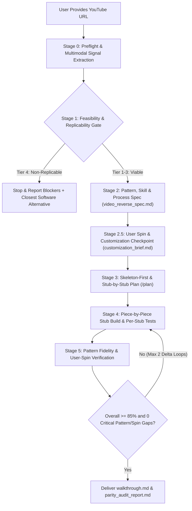

# CopyCat Builder: Meta-Instructions & Instruction-Engineering Blueprint

> **Purpose**: This document defines the **best methodology, architecture, and instruction-engineering standards** for writing Antigravity agent instructions and skills that take a YouTube video link, evaluate replicability, reverse-engineer the project's goals and requirements, plan a faithful copy, build it, and verify parity against the source video.

---

## 1. First-Principles Failure Analysis: Why Naive Video-Cloning Prompts Fail

Before writing a single line of agent instructions for CopyCat Builder, you must design explicitly against the **six systemic failure modes** of naive "watch this YouTube video and copy it" prompts:

| Failure Mode | What Goes Wrong in Naive Prompts | Required Engineering Countermeasure |
| :--- | :--- | :--- |
| **1. The Transcript-Only Fallacy** | Agents fetch YouTube captions and write code from narration alone. Narration typically omits 70%+ of critical details visible only on screen (directory trees, CSS values, CLI flags, shader uniforms, error states, layout proportions). | Mandate **multimodal ingestion** combining description links, chapters, timestamped transcripts, and scene-change keyframes inspected directly via `read_file`. |
| **2. The Feasibility Illusion** | Agents immediately scaffold code for projects that depend on inaccessible proprietary datasets, paid enterprise SaaS APIs, physical hardware peripherals, or pre-rendered concept motion graphics (CGI mockups). | Enforce a hard **Replicability & Feasibility Gate (Stage 1)** *before* planning or coding, backed by a 4-Tier verdict, single hardest bottleneck analysis, and a Bill of Materials & Tool Substitutions table. |
| **3. The Unanchored Spec & Silent-Guess Trap** | Agents write vague prose summaries or silently invent omitted measurements, library versions, and settings that break during build or diverge from the video. | Require every feature, UI token, CLI flag, and rule in `video_reverse_spec.md` to be tagged `[OBSERVED @ MM:SS]`, `[INFERRED]`, or `[UNSPECIFIED - Verify before starting]`, and separate `[MECHANICS]` from `[AESTHETICS]`. |
| **4. The Non-Deterministic Demo State Problem** | The agent builds an empty app shell (0 records, blank canvas, unseeded SQLite DB), whereas the video demonstrates a populated state (12 cards, active chart series, pre-loaded level). Side-by-side comparison becomes impossible. | Mandate a **Deterministic Demo Seed** in Stage 3 & 4 so the replica boots into the exact sample state shown at the video's primary demo timestamps. |
| **5. The "It Compiles = It Matches" Fallacy** | The agent stops once `build` or `pytest` passes without ever comparing the running project's visuals, interactions, or outputs against the video. | Enforce a **Multimodal Parity Audit & Delta Loop (Stage 5)** that stages video keyframes, drives the running replica, captures live screenshots/traces, and iterates until parity thresholds pass. |
| **6. The "Off-Camera" & Montage Blindspot** | Creators edit out unglamorous prerequisites (`.env` files, CORS/proxy configs, seed prep, asset calibration) and fast-forward through multi-step builds in montages or jump-cuts, causing immediate beginner/agent failures. | Filter intro/sponsor noise, boost keyframe density during montages, unpack steps into **Chronological & Atomic Actions** (`Critical Parameter` + `Verification`), and document **"Off-Camera" Traps & Troubleshooting** mapped to `M1`/`M2` tasks. |

### Core Design Laws for CopyCat Builder Instructions

1. **Progressive Disclosure Over Monolithic Prompts**: Never stuff extraction scripts, feasibility rubrics, web/CLI/game checklists, and comparison protocols into one massive system prompt. Split routing rules (`AGENTS.md`), workflow orchestration (`SKILL.md`), deterministic helpers (`scripts/`), and stage rubrics (`references/`).
2. **Evidence & Missing-Data Honesty Before Invention**: Filter narrative noise, never invent omitted critical parameters (flag them `[UNSPECIFIED - Verify before starting]`), and always distinguish `[OBSERVED @ MM:SS]` facts from `[INFERRED]` glue choices.
3. **Separate Mechanics from Aesthetics**: Explicitly classify structural execution (`[MECHANICS]`) apart from stylistic look-and-feel (`[AESTHETICS]`) so core behavior works before visual polish begins.
4. **Fail Fast or Substitute Explicitly**: If a video cannot be cloned literally, either stop at Tier 4 with concrete blockers or declare Tier 2 substitutions *upfront* in a Bill of Materials table and document how behavioral parity is preserved.
5. **Closed-Loop Verification**: Every CopyCat run ends with empirical comparison against golden timestamps—not with "the code compiles."

---

## 2. Antigravity Ecosystem Architecture & Tool Binding

### 2.1 Prescribed Customization Structure

Per Antigravity customization conventions (`agy-customizations`), author the final CopyCat Builder instructions as a workspace customization bundle rather than a single unstructured prompt:

```text
<workspace-root>/
├── AGENTS.md                                      # Always-on routing & strict stage-gate guardrails (< 24 KB)
└── .agents/
    └── skills/
        └── copycat-builder/
            ├── SKILL.md                           # Core 6-stage orchestrator runbook (with YAML frontmatter)
            ├── scripts/
            │   ├── extract_video_bundle.py        # Preflight + yt-dlp / transcript / description link extractor
            │   └── extract_keyframes.py           # ffmpeg scene-change + chapter/interval frame sampler
            └── references/
                ├── feasibility-rubric.md          # Archetype rules, 4-Tier gate, Dependency Substitution Matrix
                ├── domain-playbooks.md            # Web/Full-Stack, CLI/Backend/AI, and Games/Creative Coding lenses
                └── parity-comparison-protocol.md  # Keyframe staging, browser/CLI audit steps, 0-100 rubric
```

> [!IMPORTANT]
> **Why This Layout Works in Antigravity**
> - `AGENTS.md` stays lightweight (strictly under Antigravity's `24 KB` per-file cap and `20,000`-token aggregate rules budget) and acts purely as a traffic controller that enforces stage order and triggers the skill.
> - `SKILL.md` loads on demand when a user supplies a YouTube link or asks to replicate a video project.
> - `scripts/` prevent the agent from wasting turns writing ad-hoc shell one-liners for `yt-dlp` and `ffmpeg` on Windows/PowerShell.
> - `references/` keep domain-specific rubrics out of context until the agent actually enters that stage.

### 2.2 Tool & Capability Binding Matrix

Your written instructions must explicitly bind each workflow stage to the correct Antigravity primitive and sandbox policy:

| Stage | Primary Antigravity Primitives | Critical Instruction Constraints |
| :--- | :--- | :--- |
| **Stage 0: Ingestion** | `run_command` (preflight + Python scripts), `read_file` (images & JSON/text), `search_web` (linked docs/repos if needed) | Separate network calls (`BypassSandbox: true` only for the `yt-dlp`/transcript fetch step) from local `ffmpeg` frame extraction (`BypassSandbox: false`). Inspect extracted `.png` frames directly via `read_file` (Gemini multimodal vision). |
| **Stage 1: Feasibility Gate** | `read_file` (`references/feasibility-rubric.md`), `write_file` (artifact `feasibility_report.md`) | Block any application code generation until `feasibility_report.md` renders a Tier 1–3 Go verdict (or Tier 4 Hard Stop). |
| **Stage 2: Video Understanding** | `read_file` (`references/domain-playbooks.md`, keyframes, transcript), `write_file` (`video_reverse_spec.md`) | Require targeted reading of keyframe PNGs around chapters, architecture slides, IDE views, UI states, and terminal outputs. |
| **Stage 3: Planning** | `/plan` (`implementation_plan.md`) or plan artifact with `RequestFeedback: true` | Require milestone dependency ordering, explicit file map, and a **Deterministic Demo Seed** task before user sign-off. |
| **Stage 4: Build** | `write_file`, `edit_file`, `run_command`, `run_workflow` (optional for parallel module builds) | Keep builds/tests sandboxed (`BypassSandbox: false`). Use `run_workflow` (`parallel` with `workspace="branch"`) only when the replica cleanly decomposes into independent modules. |
| **Stage 5: Build & Compare** | `invoke_subagent` (`browser` with `Model: "flash"`), `run_command` (CLI/HTTP parity harness), `read_file`, `write_file` (`parity_audit_report.md`, `walkthrough.md`) | **Browser Staging Rule**: Copy 5–10 golden keyframes to `<ArtifactDir>/browser_sandbox/references/<frame>.png` before invoking the `browser` subagent. Verify claims against `BROWSER_HOST_FACTS`. **Local Server Rule**: Start user-preview or browser-tested servers with `BypassSandbox: true`; probe sandbox-only APIs in the same `run_command`. |

---

## 3. The 6-Stage Instruction Design Blueprint

Below is the exact behavioral specification your CopyCat Builder instructions must enforce across all six stages.



---

### Stage 0: Preflight & Multimodal Signal Extraction

**Why instructions fail here**: Agents assume `yt-dlp` and `ffmpeg` are installed, waste context on sponsor reads/intros, or miss rapid coding/build steps hidden inside timelapses and montages.

**What your instructions must require**:
1. **Tool Preflight Check**: Verify `python`, `yt-dlp`, and `ffmpeg` availability before running extraction. (Note: On systems where only `python` is pre-installed, instruct the agent to check `Get-Command` / `where.exe` first and either run a Python fallback via `youtube-transcript-api` + `yt-dlp` pip module or clearly report missing system binaries such as `ffmpeg` rather than failing obscurely).
2. **Description & Linked-Asset Triage First**: Extract full video metadata (`title`, `duration`, `chapters`, `description`, `tags`). Parse every URL in the description to check if the creator linked:
   - An official GitHub repository / Gist / CodePen / Replit / Hugging Face Space
   - Package versions, datasets, or API documentation
   - *Rule*: Never discard creator-linked technical notes, but still verify whether the video diverges from the repo or omits files.
3. **Noise Filtering & Sponsor Stripping**:
   - Explicitly identify and exclude intros, sponsor reads, channel plugs, and narrative fluff from active specification indexing (tagging ignored intervals `[NOISE @ MM:SS-MM:SS]` in `video_context_index.json`) so downstream specs extract only technical and creative execution details.
4. **Transcript + Montage-Aware Keyframe Extraction**:
   - Extract timestamped transcript (manual captions preferred over auto-generated; retain `[MM:SS]` markers).
   - Download a bounded-resolution video stream (`<= 720p`, MP4) into `<ArtifactDir>/scratch/video/` (never cluttering the project repository root!) using `BypassSandbox: true` solely for the network fetch.
   - Extract keyframes using a three-tier sampling strategy:
     - **Scene-change detection** (`ffmpeg` `select='gt(scene,0.28)'`) to capture UI switches, slide transitions, terminal runs, and code editor views.
     - **Montage & jump-cut high-density burst**: Whenever narration pauses or visual scene changes cluster rapidly (indicating a timelapse, coding montage, or accelerated workflow), increase sampling density (e.g., every 2–5 seconds) so no atomic edit or setting dialog is skipped.
     - **Chapter/interval anchor fallback** (e.g., 1 frame at every chapter boundary + 1 frame every 20–30s if scene detection yields too few frames, capped safely to avoid context bloat).
   - Output a `video_context_index.json` mapping `{ timestamp_sec, timestamp_mmss, chapter, segment_type, transcript_excerpt, keyframe_path }`.
5. **Multimodal Inspection Pass**: Instruct the agent to inspect keyframe PNGs in small thematic batches with `read_file`—specifically targeting:
   - Opening overview / final demo reveal
   - Architecture diagrams / tech-stack slides
   - File tree / `package.json` / `pyproject.toml` / `Cargo.toml` frames
   - Montage sequences, IDE/settings dialogs, UI views, terminal outputs, or canvas/game states.

---

### Stage 1: Replicability & Feasibility Gate

**Why instructions fail here**: Without an explicit go/no-go gate, agents burn 30 minutes scaffolding a project that fundamentally cannot run locally, miss the single hardest technical step, or silently fake core functionality without telling the user.

**What your instructions must require**:
1. **Project Overview, Bottleneck & Time Profile**:
   - **Core Concept**: 1–2 sentences summarizing what is being built and the underlying technical/creative technique.
   - **Skill Level & Single Hardest Bottleneck**: Identify the single most technically demanding step in the video (e.g., custom WebGL shader math, OAuth callback orchestration, real-time audio FFT sync).
   - **Estimated Time Split**: Separate **Active Working/Build Time** from **Passive/Compute Time** (e.g., `npm install`, Docker image builds, vector indexing, model weight downloads, rendering/baking).
2. **Classify Project Archetype** (one primary, optional secondary):
   - **Archetype A — Web Apps, UIs & Full-Stack Demos**: SPAs, Next.js/React/Vue dashboards, SaaS clones, interactive landing pages, browser extensions.
   - **Archetype B — CLI Tools, Scripts, Backend Services & AI/ML Workflows**: Python/Node/Go/Rust CLIs, REST/WebSocket APIs, scrapers, RAG/agent pipelines, data processors.
   - **Archetype C — Games, Animations & Creative Coding**: HTML5 Canvas/WebGL/Three.js/P5.js sketches, shaders, 2D/3D browser games, Pygame/Godot-style interactive simulations, CSS/GSAP/Framer Motion generative visuals.
3. **Audit Hard Blockers vs. Soft Blockers**:
   - *Hard Blockers*: Physical hardware / IoT sensors not simulated; closed proprietary backend logic never shown and non-inferable; undisclosed private training datasets essential to the value proposition; pure CGI/After Effects concept video masquerading as live software.
   - *Soft Blockers*: Paid APIs (OpenAI, Stripe, Twilio, Google Maps, proprietary SaaS), hosted cloud databases, OAuth logins, or large external media assets.
4. **Build the Bill of Materials (BOM) & Tool Substitutions Table**:
   Your instructions must require a structured BOM table matching `| Item / Software | Exact Spec / Setting Used | Purpose in Project | Accessible Alternative |` covering every observed library, runtime, API, asset, and tool, backed by deterministic local substitution patterns:
   - *Paid LLM / Vision / Image API* -> Configurable adapter supporting either user-provided `.env` key **or** deterministic local mock/replay mode mirroring the exact JSON schema and streaming cadence shown in the video.
   - *Cloud DB / Auth (Supabase, Firebase, Auth0, Postgres)* -> Local SQLite / JSON store + one-click dev auth bypass seeded with the demo user.
   - *Paid SaaS Webhooks (Stripe, Slack, Resend)* -> Local webhook simulator / mock event inbox with matching payloads.
   - *Proprietary Stock/Media Assets* -> Local procedural SVG/Canvas placeholders, `image-generator` subagent assets, or deterministic fixtures matching dimensions/aspect ratios.
5. **Assign a 4-Tier Replicability Verdict** in `feasibility_report.md`:
   - **Tier 1 — Direct Replica**: Stack, logic, assets, and runtime are completely reproducible locally with zero core substitutions.
   - **Tier 2 — Functional Equivalent**: Core behavior and UX are fully replicable locally by applying documented BOM Substitutions (user must approve substitutions).
   - **Tier 3 — Scoped Vertical Slice**: The video showcases an expansive multi-month platform or broad tutorial series; only the demonstrated core flow(s) can be replicated cleanly within scope.
   - **Tier 4 — Non-Replicable (Hard Stop)**: Blocked by hardware, non-inferable proprietary black boxes, or non-software CGI. **Mandatory behavior**: Halt replication, document exact blockers with `[MM:SS]` evidence, and propose 1–2 closest viable Tier 2/3 alternatives.

---

### Stage 2: Deep Video Understanding & Reverse Specification (`video_reverse_spec.md`)

**Why instructions fail here**: Agents translate a 15-minute video into 5 vague bullet points, guess hidden parameters silently, blur cosmetic choices with core architecture, and overlook unshown setup steps edited out by the creator.

**What your instructions must require**:
1. **3-Tier Epistemic Tagging Contract**: Every requirement, component, schema field, or parameter in `video_reverse_spec.md` MUST carry one of three tags:
   - `[OBSERVED @ MM:SS]` — Directly seen in a keyframe or heard/read verbatim in the transcript/code frame.
   - `[INFERRED]` — Standard, safe engineering fill-in for glue code that does not affect core parameters or measurements.
   - `[UNSPECIFIED - Verify before starting]` — Critical measurement, hidden config, version constraint, shader uniform, prompt parameter, or asset spec skipped by the creator. **Hard rule**: NEVER silently guess an `[UNSPECIFIED]` parameter; surface all of them explicitly in Stage 2/3 so the user confirms them or approves a documented default before coding.
2. **Mechanics vs. Aesthetics Separation**:
   - Classify every requirement and step as either **`[MECHANICS]`** (structural logic, data flow, state rules, and dependencies required for the project to function) or **`[AESTHETICS]`** (stylistic palette, typography, motion timing, or cosmetic choices that can be customized without breaking function).
3. **Chronological & Atomic Replication Blueprint**:
   - Break complex sequences and fast-forward montages into sequential, single-action steps (**one action per step**) grouped into logical phases (`Phase 1: Prep & Layout`, `Phase 2: Assembly/Core Execution`, `Phase 3: Finishing`).
   - Require every step to follow this exact format:
     - **`[MM:SS] Action Title`** (`[MECHANICS]` | `[AESTHETICS]`): Clear imperative instruction.
       - *Critical Parameter*: Exact measurement, ratio, library version, CLI flag, node setting, or `[UNSPECIFIED - Verify before starting]`.
       - *Verification*: How to confirm this atomic step succeeded before proceeding.
4. **"Off-Camera" Traps & Troubleshooting Inventory**:
   - Explicitly list **2–5 unshown steps** the creator likely performed off-camera or edited out (e.g., `.env` secrets setup, CORS/proxy rules, database schema initialization, font/asset downloads, port conflicts, calibration/test fixtures) that would break a clean-room build if skipped.
   - Bind every identified off-camera trap directly to a prerequisite task in Stage 3 (`M1`/`M2`).
5. **Archetype-Specific Extraction Lenses**: Direct the agent to load `references/domain-playbooks.md` and extract the active lens:
   - **Lens A (Web / Full-Stack UI)**:
     - Layout skeleton (sidebar, topbar, split panes, grid proportions)
     - Visual design tokens (background/surface hex palette sampled from keyframes, accent colors, typography scale, border radii, shadows/glassmorphism)
     - Complete component & route inventory
     - Interactive state machine (empty, loading, populated, error, modal/drawer states)
     - Motion/transitions (hover effects, stagger reveals, drag-and-drop physics).
   - **Lens B (CLI / Backend / AI Workflow)**:
     - Exact command invocation syntax, subcommands, flags, and environment variables
     - Terminal UX (spinners, progress bars, ANSI colors, table formatting, streaming token behavior)
     - API routes / request-response JSON contracts / WebSocket events
     - AI pipeline stages (system prompts, tool definitions, chunking/embedding/model routing)
     - Exit codes, logging format, and error recovery behavior.
   - **Lens C (Games / Animations / Creative Coding)**:
     - Coordinate system, viewport/aspect ratio, and rendering engine (Canvas 2D, WebGL/Three.js, SVG, Pygame)
     - Core loop & timing (fixed vs. variable `dt`, FPS target, physics/easing curves)
     - Entities, components, state transitions (title -> active play -> pause -> game over/win)
     - Controls & input bindings (keyboard, mouse/drag, touch) and audio cues
     - Shader/particle/color palette aesthetics and HUD layout.
6. **Golden Keyframes & Deterministic Demo Seed Spec**:
   - Designate **5–10 Golden Keyframes** (`[MM:SS]`) spanning initial boot, primary workflow, edge/error state, and climax result.
   - Define the **exact seed payload** (sample records, mock API responses, initial level/canvas state, or input fixtures) required so the built replica can reproduce every Golden Keyframe verbatim.

---

### Stage 3: Skeleton-First & Stub-by-Stub Replication Planning

**Why instructions fail here**: Agents attempt a single giant write pass, hardcode the UI solely to the video's demo text, mix UI polish with broken data models, or skip writing tests and demo seeds.

**What your instructions must require**:
1. **Skeleton-First Architecture (`Stage 3A`)**: Scaffold modular directories and documented `TODO(stub)` interfaces (`<= 250–300` lines per file) separating the **User-Parameterized Core Engine** (accepting custom inputs + `.env` live API keys) from the **1-Click Video Demo Preset**.
2. **Standardized 4-Milestone Stub Plan (`Stage 3B`)** (inside `/plan` / `implementation_plan.md`):
   - **Milestone 1 — Workspace, `.env` Config & "Off-Camera" Prerequisites**: Directory layout, BOM dependencies, build/run scripts, `.env.example`, `"Off-Camera"` trap mitigations, explicit resolution of `[UNSPECIFIED - Verify before starting]` items, and local adapter interfaces.
   - **Milestone 2 — Core Dynamic Engine & Loadable Demo Preset (`[MECHANICS]`)**: Parameterized domain logic / simulation loop / AI pipeline (supporting live API or dynamic local synthesis) plus a 1-click Demo Preset matching the video's demo dataset.
   - **Milestone 3 — Modular User Flows (`[MECHANICS]`)**: Implementing each stub 1-to-1 with end-to-end flows tied to Golden Keyframes `[MM:SS]` and custom user inputs.
   - **Milestone 4 — Visual Polish, Animations & Edge Cases (`[AESTHETICS]`)**: Styling refinement, transitions, responsive/terminal formatting, and error states observed in the video.
3. **Traceability & Per-Stub Test Requirement**: Every task in the plan must cite its target stub file/symbol, `[OBSERVED @ MM:SS]` requirement IDs, and exact per-stub unit/API/DOM test.
4. **Human Approval Checkpoint**: Require explicit user approval whenever `[UNSPECIFIED - Verify before starting]` parameters exist, or when Tier 2 (substitutions) / Tier 3 (vertical slice scoping) applies, before entering Stage 4.

---

### Stage 4: Piece-by-Piece Stub Execution & Per-Stub Verification

**What your instructions must require**:
1. **One Stub at a Time**: Implement and document (`docstring`/`JSDoc`) one stub at a time in `M1 -> M4` order. Do not start `M4` polish while `M2` data contracts or `M3` core interactions fail.
2. **Mandatory Per-Stub Gate**: Run each stub's dedicated unit/API/DOM test inside the sandbox (`BypassSandbox: false`) before moving to the next stub.
3. **Zero Dead Controls & Anti-Hardcoding**: Verify every button, form, and interactive control executes real logic on **both** custom user inputs and the 1-click Video Demo Preset.
4. **Parallel Execution Rule (`run_workflow`)**: Only spawn parallel `run_workflow` agents (`workspace="branch"`) if the architecture has cleanly decoupled modules with frozen stub interfaces defined in Stage 3A.

---

### Stage 5: "Build & Compare" Multimodal Parity Audit & Delta Loop

**This is the defining differentiator of CopyCat Builder.** Your instructions must enforce an empirical, visual-and-functional comparison workflow tailored to the project archetype:

#### 5.1 Staging Reference Evidence (Antigravity-Specific)
- Copy the 5–10 Golden Keyframes from `<ArtifactDir>/scratch/frames/` into `<ArtifactDir>/browser_sandbox/references/video_MM_SS.png` (so the `browser` subagent can inspect them via `read_file` alongside the live app).

#### 5.2 Archetype Comparison Execution
- **For Web/Full-Stack UI & Browser-Based Games/Creative Coding**:
  1. Launch the local dev/preview server (`BypassSandbox: true` when the `browser` subagent or user needs to reach `localhost:PORT`, per Antigravity Windows sandbox rules).
  2. Delegate to the `browser` subagent (`Model: "flash"`) with explicit instructions to:
     - Read the staged reference frames in `<ArtifactDir>/browser_sandbox/references/`.
     - Open `http://localhost:<PORT>`, resize to match the video's aspect ratio (typically `1280x720` or `1440x900`), and execute the exact click/type/keyboard sequence matching each Golden Keyframe timestamp.
     - Capture live screenshots (`replica_MM_SS.png`), check console/network logs for zero runtime errors, and return observed DOM/visual differences.
  3. Cross-check the subagent's claims against `BROWSER_HOST_FACTS` and inspect both `video_MM_SS.png` and `replica_MM_SS.png` directly in the parent agent via `read_file` before scoring!
- **For CLI Tools, Backend APIs & AI Pipelines**:
  1. Execute a deterministic verification script via `run_command` that feeds the exact CLI flags, stdin, or HTTP payloads observed in the video keyframes.
  2. Capture stdout/stderr, formatting, HTTP JSON responses, latency/streaming behavior, and exit codes.
  3. Compare captured outputs side-by-side against the terminal/API frames inspected via `read_file`.

#### 5.3 Quantitative 4-Dimension Parity Rubric (0–100 Scale)

Every CopyCat Builder run must produce `parity_audit_report.md` scoring these four dimensions:

| Dimension | Weight | What Is Compared | Passing Threshold |
| :--- | :--- | :--- | :--- |
| **1. Visual / Presentation Parity** | 30% | Layout grid, color palette, typography, spacing, component hierarchy (or CLI table/ANSI layout / canvas shader look) vs. Golden Keyframes. | `>= 85` |
| **2. Functional / Feature Parity** | 35% | Every `[OBSERVED @ MM:SS]` interaction, button, route, CLI flag, or game mechanic works end-to-end without console/runtime errors. | `>= 90` |
| **3. Interaction / Motion Parity** | 15% | State transitions, hover/focus feedback, animations, game tick responsiveness, or CLI streaming UX feel faithful to video cadence. | `>= 80` |
| **4. Data / Output Parity** | 20% | Seeded demo state, displayed metrics, API/CLI outputs, and edge-case handling match the video's demonstrated scenarios (accounting for declared Tier 2 substitutions). | `>= 85` |

#### 5.4 The Bounded Delta Fix Loop
- If **any dimension fails its threshold** or any **Critical `[OBSERVED]` feature** is missing/broken:
  1. Log exact deltas (`[DELTA-01] @ 02:14 — Sidebar uses 280px instead of 240px and lacks badge count`).
  2. Fix the deltas in Stage 4.
  3. Re-run the Stage 5 parity audit on the affected states.
- **Loop Cap**: Allow a **maximum of 2 full Delta Fix Loops** automatically. If parity still fails after 2 loops, surface remaining deltas transparently in `parity_audit_report.md` and `walkthrough.md` instead of looping endlessly.

---

## 4. Instruction Authoring Quality Checklist & Anti-Pattern Guards

Before deploying any generated CopyCat Builder `AGENTS.md`, `SKILL.md`, or reference playbooks, audit them against this 12-point quality gate:

1. **Frontmatter Validity**: Does `SKILL.md` define `name` (lowercase hyphenated) and a clear third-person `description` stating *what* it does and *when* to trigger?
2. **Rule Budget Discipline**: Is `AGENTS.md` well under `24 KB` and focused solely on routing + non-negotiable gates (no duplicated coding guidelines)?
3. **Zero Unsandboxed Leakage**: Do instructions isolate `BypassSandbox: true` strictly to network video fetching and browser-accessible local servers, keeping file processing/builds/tests sandboxed?
4. **No Clutter in Project Root**: Are downloaded video files, raw transcripts, and intermediate extracted frames stored under `<ArtifactDir>/scratch/` rather than polluting the target replica's source tree?
5. **Hard Gate Enforcement**: Is the agent explicitly forbidden from writing application source files before `feasibility_report.md` (Tier 1–3) and `video_reverse_spec.md` exist?
6. **Epistemic Honesty & Missing-Data Guard**: Do instructions mandate 3-tier tagging (`[OBSERVED @ MM:SS]`, `[INFERRED]`, and `[UNSPECIFIED - Verify before starting]`), separate `[MECHANICS]` from `[AESTHETICS]`, and prohibit claiming `browser` results without `BROWSER_HOST_FACTS`?
7. **Noise Filtering & Montage Unpacking**: Do Stage 0 and Stage 2 filter intros/sponsors/plugs, boost keyframe density during montages, and break workflows into sequential single-action steps (`Critical Parameter` + `Verification`)?
8. **BOM & Off-Camera Trap Coverage**: Does Stage 1 require a full `Bill of Materials & Tool Substitutions` table + single hardest bottleneck + active/passive time split, and does Stage 2/3 surface `"Off-Camera" Traps & Troubleshooting` into `M1`/`M2` tasks?
9. **Archetype Coverage**: Are Web/Full-Stack, CLI/Backend/AI, and Games/Creative Coding each given concrete extraction lenses and comparison methods?
10. **Browser Staging Correctness**: Do Stage 5 instructions explicitly stage reference keyframes into `<ArtifactDir>/browser_sandbox/references/<filename>` (single-segment filename) before delegating to `browser`?
11. **Deterministic Seed Mandate**: Does Stage 3/4 require seeding the exact demo state shown in the video so Stage 5 comparison is apples-to-apples?
12. **Bounded Iteration**: Are Stage 5 delta loops capped (e.g., max 2 iterations) with clear escalation when a gap traces back to a Tier 2 substitution or `[UNSPECIFIED]` parameter?

---

## 5. Master Generator Meta-Prompt (Ready to Execute)

Copy and paste the prompt below into a fresh Antigravity turn whenever you are ready to generate the live CopyCat Builder skill suite in this workspace. It uses [INSTRUCTION_BLUEPRINT_TEMPLATE.md](file:///c:/Projects_MCM/CopyCat_Builder/templates/INSTRUCTION_BLUEPRINT_TEMPLATE.md) and all rules established above.

````markdown
You are an Antigravity Customization Architect. Read `META_INSTRUCTIONS.md` and `templates/INSTRUCTION_BLUEPRINT_TEMPLATE.md` in full, and inspect `C:\Users\mcmcc\.gemini\antigravity\builtin\skills\agy-customizations\SKILL.md` (and its `docs/skills.md` and `docs/rules.md`).

Your task is to generate the complete, production-ready **CopyCat Builder** customization package inside this workspace (`c:\Projects_MCM\CopyCat_Builder`):

1. **`AGENTS.md`** (Workspace Root Rule, strictly < 24 KB)
   - Routes any request containing a YouTube URL or asking to replicate/copy a video project to `.agents/skills/copycat-builder/SKILL.md`.
   - Enforces the 6-stage state machine and forbids writing application code before Stage 1 (`feasibility_report.md` with Tier 1–3 verdict) and Stage 2 (`video_reverse_spec.md`) are complete.
   - Enforces flagging omitted critical parameters as `[UNSPECIFIED - Verify before starting]` rather than silently guessing.
   - Enforces storing downloaded media and extracted frames under the active conversation's `<ArtifactDir>/scratch/` (never inside the generated project root).

2. **`.agents/skills/copycat-builder/SKILL.md`**
   - Valid YAML frontmatter (`name: copycat-builder`, third-person trigger `description`).
   - Concise orchestrator runbook for Stages 0 through 5 with strict operating rules (filter noise, flag `[UNSPECIFIED - Verify before starting]`, separate `[MECHANICS]` from `[AESTHETICS]`, unpack montages into chronological atomic actions, and capture `"Off-Camera" Traps`).
   - Links cleanly to `./scripts/` and `./references/` using progressive disclosure.

3. **`.agents/skills/copycat-builder/scripts/`**
   - `extract_video_bundle.py`: Python 3 CLI script that checks dependencies (`yt-dlp`, `youtube-transcript-api`), downloads bounded video metadata, chapters, description URLs (highlighting GitHub/Gist/docs links), and timestamped transcripts into a target output directory, outputting a structured JSON manifest with noise/sponsor interval hints. Handles missing optional packages gracefully with actionable error messages.
   - `extract_keyframes.py`: Python 3 CLI script wrapping `ffmpeg` to extract scene-change keyframes, montage high-density burst frames, and chapter/interval fallback PNGs named `frame_MM_SS.png`, merging them with the transcript manifest into `video_context_index.json`.

4. **`.agents/skills/copycat-builder/references/`**
   - `feasibility-rubric.md`: Archetype classifier (Web/Full-Stack, CLI/Backend/AI, Games/Creative Coding), Core Concept & Single Hardest Bottleneck guide, Active vs. Passive/Compute time estimator, Hard vs. Soft blocker checklists, the Bill of Materials (BOM) & Tool Substitutions table, and the Tier 1–4 Verdict Rubric.
   - `domain-playbooks.md`: Deep reverse-engineering & build checklists for each of the 3 target archetypes, enforcing 3-tier epistemic tagging (`[OBSERVED @ MM:SS]`, `[INFERRED]`, `[UNSPECIFIED - Verify before starting]`), `[MECHANICS]` vs. `[AESTHETICS]` separation, Chronological Atomic Step formatting (`Critical Parameter` + `Verification`), `"Off-Camera" Traps & Troubleshooting`, and Deterministic Demo Seed rules.
   - `parity-comparison-protocol.md`: Step-by-step Stage 5 comparison guide covering staging golden frames to `<ArtifactDir>/browser_sandbox/references/`, running the `browser` subagent (`Model: "flash"`) + verifying against `BROWSER_HOST_FACTS`, running CLI/API trace diffs, scoring the 4-dimension 0–100 parity rubric, and executing up to 2 bounded Delta Fix Loops.

After generating all files:
- Verify `AGENTS.md` size is under 24 KB.
- Run `python -m py_compile` on both Python scripts in `.agents/skills/copycat-builder/scripts/` and run `--help` on both scripts to verify CLI syntax.
- Verify all markdown links inside `SKILL.md` resolve to existing files.
- Report a concise summary of created files and verification outputs.
````
